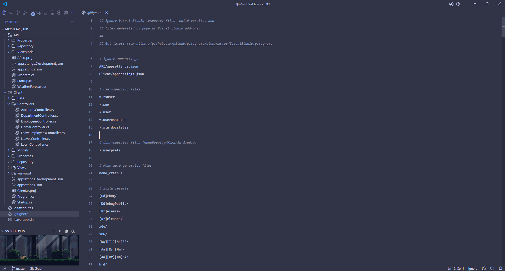

# 🌌 Minimalist Zed-Inspired VS Code Setup

My personal **Visual Studio Code** configuration crafted for a clean, flat, and distraction-free coding experience inspired by **Zed Editor**, styled with the **Catppuccin Frappé** palette and **Blue** accents.

> `@}->--  C'est la vie ᓚᘏᗢ`

---

## 📸 Preview

---

## ✨ Highlights

- **Zed-Like Flat UI:** Eliminates panel borders and split-view dividers across the workbench using `catppuccin.workbenchMode: "minimal"`, `catppuccin.extraBordersEnabled: false`, and `workbench.experimental.modernUI: false`.
- **Distraction-Free Layout:** Strips away visual clutter by hiding the minimap, breadcrumbs, command center, layout controls, and editor title actions, while positioning the Activity Bar at the `top`.
- **Crisp Typography & Spacing:** Uses **FiraCode NF** (`12px`) with font ligatures enabled and a generous line height (`29`) for comfortable long-form reading and coding.
- **Monochrome Iconography:** Pairs **Catppuccin Icons** in monochrome mode (`catppuccin-icons.monochrome: true`) so file trees blend seamlessly into the base background.
- **Clean Formatting & Linting:** Configured with **Prettier** as the default formatter (format on save) alongside **ESLint** flat config support and **Intelephense** for PHP.

---

## 🧩 Extensions

### Theme & Icons
- **Catppuccin for VSCode** (`Catppuccin.catppuccin-vsc`) — *Catppuccin Frappé* theme
- **Catppuccin Icons for VSCode** (`Catppuccin.catppuccin-vsc-icons`) — Monochrome icon theme

### Formatting, Linting & Git
- **Prettier - Code formatter** (`esbenp.prettier-vscode`)
- **ESLint** (`dbaeumer.vscode-eslint`)
- **GitLens** (`eamodio.gitlens`) — Configured with inline blame, CodeLens, and hover popups disabled

*(Other extension-specific rules in `settings.json` can be safely kept, customized, or removed depending on your own workflow.)*

---

## 🚀 Installation & Usage

1. **Install Font:** Download and install **[FiraCode Nerd Font](https://www.nerdfonts.com/font-downloads)** on your system.
2. **Install Extensions:** Install the extensions listed above via the VS Code Extensions Marketplace (`Ctrl + Shift + X`).
3. **Apply Configuration:**
   - Open the Command Palette in VS Code (`Ctrl + Shift + P`).
   - Run **Preferences: Open User Settings (JSON)**.
   - Copy and paste the contents of [`settings.json`](./settings.json) into your User Settings file and save (`Ctrl + S`).
